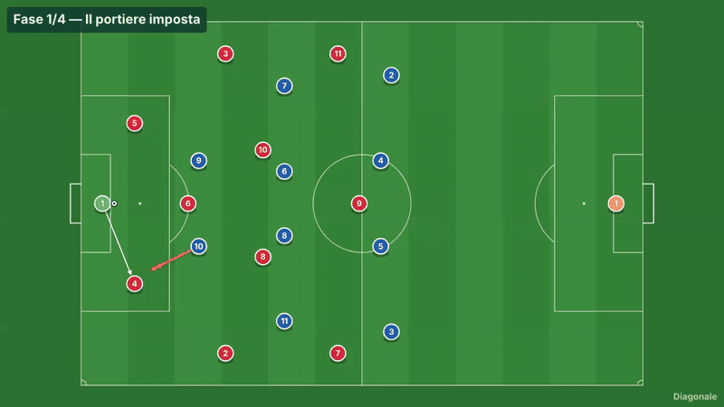
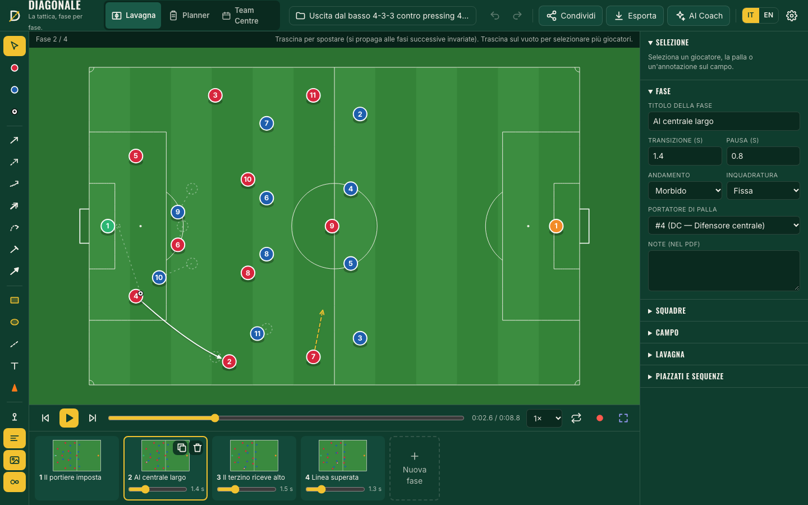
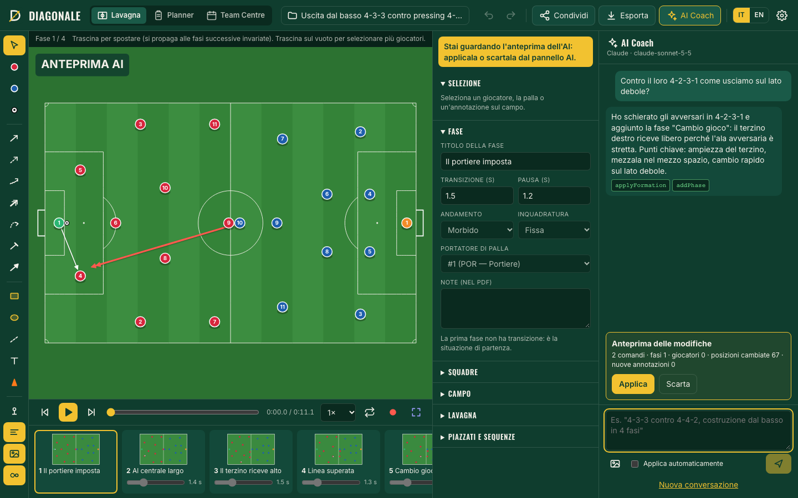
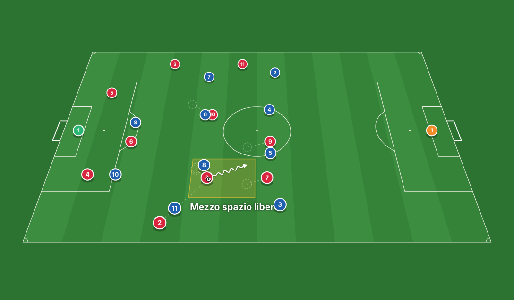
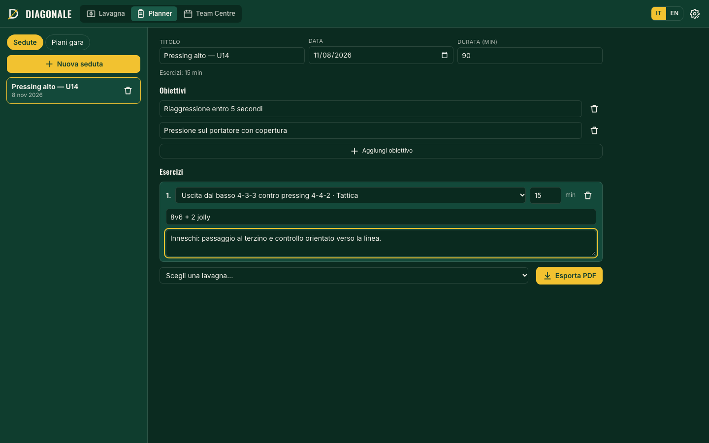
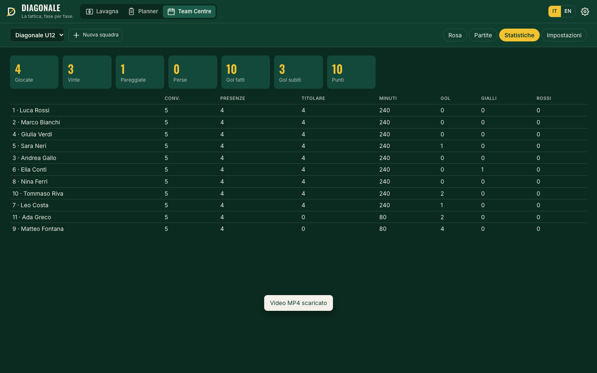
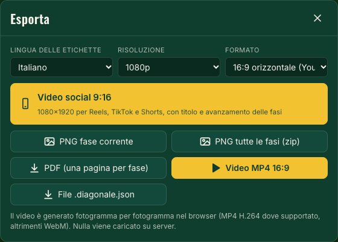
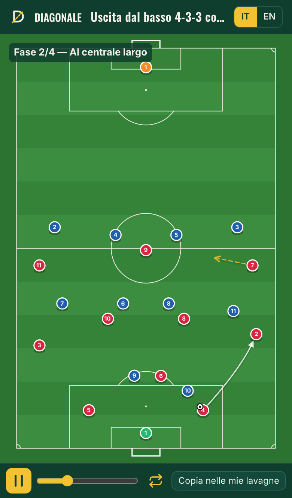
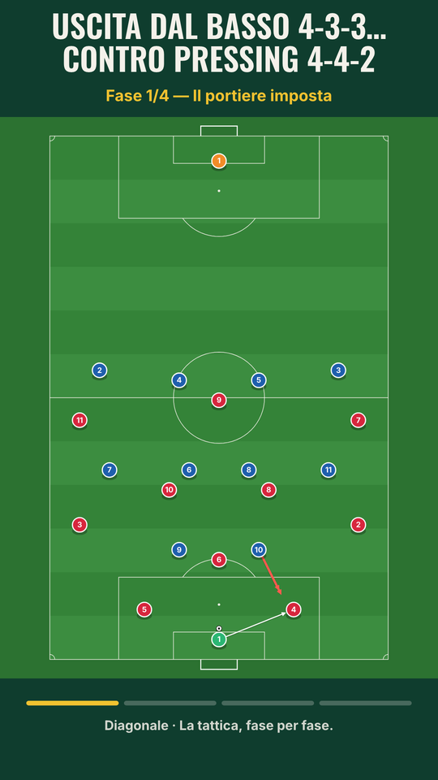

<p align="center"></p>

<h1 align="center">Diagonale</h1>
<p align="center"><b>Tactics, phase by phase.</b> A free, open-source animated tactics board for football (soccer) coaches.<br><i>La tattica, fase per fase. Lavagna tattica animata, gratuita e open source, per allenatori di calcio.</i></p>
<p align="center"><a href="#english">🇬🇧 English</a> · <a href="#italiano">🇮🇹 Italiano</a></p>
<p align="center">
  <a href="https://github.com/iltempe/diagonale/releases/latest"></a>
  <a href="https://github.com/iltempe/diagonale/actions/workflows/ci.yml"></a>
  <a href="LICENSE"></a>
  <a href="https://diagonalecalcio.it/"></a>
</p>
<p align="center"><a href="https://diagonalecalcio.it/app/"><b>▶ Open the app · Apri l'app</b></a> · <a href="https://diagonalecalcio.it/">Website · Sito</a> · <a href="https://github.com/iltempe/diagonale/releases/latest"><b>⬇ Mac · Windows · Linux</b></a></p>

<p align="center"><a href="https://diagonalecalcio.it/app/"></a></p>

<a id="english"></a>

## 🇬🇧 English

You draw a game situation on a pitch measured in real meters, split it into **phases**, and Diagonale animates the transition from one phase to the next like a video. Then you share it with a link that also opens on phones, export it to MP4, PNG or PDF, or let the **AI Coach** build it with the model of your choice.

It runs in the browser with no installation and no account: your boards stay on your device and the app also works offline (PWA). There is also a **desktop app** for macOS, Windows and Linux, available from the [releases](https://github.com/iltempe/diagonale/releases/latest).

### Features

- **Editor**: home and away players, ball, arrows in 7 styles (pass, run, carry, press, lofted ball, block, shot), zones, lines, text and 17 training equipment items. Multi-selection, tap-to-place on mobile, draggable curves and keyboard shortcuts.
- **Phases and animation**: timeline with thumbnails, draggable duration, easing, lofted ball with shadow, camera that follows the ball, playback at 0.5×/1×/2× with loop.
- **Pitch**: 9 views (full, halves, thirds, penalty box, flanks), 4 surfaces, horizontal or vertical orientation, **broadcast perspective view** and metric grid for drills.
- **25 formations**, including youth 5, 7 and 9-a-side ones, and **5 set-piece routines**. You can save your own sequences and reapply them to other boards.
- **Sharing**: a `#/d/…` link that holds the compressed board (about 2–6 KB, no server involved). It opens full screen and switches to portrait on phones.
- **Export**: PNG of the current phase or of all phases (zip), PDF with one page per phase and its notes, **H.264 MP4** video at 720p or 1080p rendered frame by frame. The **Social video 9:16** button produces a 1080×1920 video for Reels, TikTok and Shorts in one click, with title, current phase and progress bar; 16:9, 4:5 and 1:1 formats are available too. Import and export of `.diagonale.json` files.
- **English and Italian**: switching language is instant; the same choice applies to export labels and to the AI.
- **AI Coach**: works with Claude, OpenAI, Gemini, OpenRouter, Mistral, Groq, DeepSeek and with local models through Ollama or LM Studio. You use your own key, which stays in your browser. AI changes are shown as a preview and can be undone in a single step.
- **MCP server**: Claude Desktop and Claude Code can create and edit boards as files, or *live* in the open app.
- **Team Talk**: record your voice while the animation plays; it stays in sync in presentation mode and is included in the MP4 video.
- **Planner**: training sessions (drills, duration, objectives) as A4 PDF, and match plans by game moment in a single PDF.
- **Team Centre**: squad, calendar with ICS import/export, call-ups, results, minutes, goals, cards, stats, and reports for parents with name privacy (initials by default).
- **Player photos and flags** on the pitch.
- **Optional cloud (Supabase)**: sign-in, sync across devices and short links with audio. See below how to enable it.

### Screenshots

| Editor with phase timeline | AI Coach with preview |
|---|---|
|  |  |
| **Broadcast view** | **Session planner** |
|  |  |
| **Team Centre** | **Export, including 9:16 social** |
|  |  |

<p align="center">
  
  &nbsp;
  
</p>
<p align="center"><i>Shared link opened on a phone · frame of a 9:16 social video</i></p>

*The screenshots show the Italian interface; switch to English with the IT/EN selector in the app.*

**Try it now:** [diagonalecalcio.it/app](https://diagonalecalcio.it/app/), nothing to install and no account needed.

### Does your club use Diagonale?

Put the badge on your club's website: generate it, with the club name, in the [badge section of the website](https://diagonalecalcio.it/#badge), or copy this code:

```html
<a href="https://diagonalecalcio.it/?ref=badge" target="_blank" rel="noopener" title="We use Diagonale"></a>
```

<a href="https://diagonalecalcio.it/?ref=badge"></a>
<a href="https://diagonalecalcio.it/?ref=badge"></a>

Light and Italian versions are also available (`diagonale-{it,en}-{dark,light}.svg`), as well as a plain HTML version that loads nothing from external servers.

### Structure

```
packages/core        model, Zod schema, commands, undo/redo, animation (pure, headless TypeScript)
packages/render      Konva renderer shared by editor, player and exports
packages/ai          model-agnostic AI providers + agent loop
packages/mcp-server  MCP server (stdio / Streamable HTTP, file and live modes)
apps/web             React 19 web app (Vite, Zustand, Dexie, i18next)
apps/desktop         Electron desktop app (macOS, Windows, Linux)
apps/site            static launch website (bilingual)
data/                formations and routines as JSON (generated from packages/core)
supabase/            schema and AI proxy for the optional cloud
```

Every board change goes through a typed **command bus**. The interface, the AI and MCP all use the same commands, which also provide undo/redo and the AI tool definitions (generated from the Zod schemas).

### Development

You need Node ≥ 20 and pnpm 9.

```bash
pnpm install
pnpm dev                 # http://localhost:5173
pnpm test                # unit tests (core, render, ai, mcp-server)
pnpm typecheck && pnpm lint && pnpm check:i18n
pnpm --filter @diagonale/web e2e    # Playwright
```

Every push to `main` deploys to GitHub Pages (`.github/workflows/pages.yml`): website at `diagonalecalcio.it`, app at `diagonalecalcio.it/app/`.

#### Desktop app

```bash
pnpm --filter @diagonale/desktop start      # run in development
pnpm --filter @diagonale/desktop dist       # packages for the current OS in apps/desktop/release
```

On every `v*` tag the `release.yml` workflow builds the apps for macOS, Windows and Linux together with `diagonale-mcp.js`, and publishes them in the GitHub release.

#### Optional cloud (Supabase)

1. Create a Supabase project and apply `supabase/migrations/0001_init.sql`.
2. In *Authentication* enable email (magic link) and, if you like, Google; add `https://diagonalecalcio.it/app/` to the redirect URLs.
3. In the GitHub repository set the variables `VITE_SUPABASE_URL` and `VITE_SUPABASE_ANON_KEY` (*Settings → Secrets and variables → Actions → Variables*) and re-run the deploy.

Without these variables the app stays fully local and share links carry the board in the address.

#### AI with local models

- **Ollama**: start it with `OLLAMA_ORIGINS=* ollama serve`, then pick "Ollama (local)" in the settings. In the desktop app no extra configuration is needed.
- **LM Studio**: enable CORS in the local server (not needed in the desktop app).

If a model does not support tool calling, untick the option: the agent switches to a validated JSON protocol, with at most 2 correction attempts.

#### MCP server

See [`packages/mcp-server/README.md`](packages/mcp-server/README.md).

### What's new

See [`CHANGELOG.md`](CHANGELOG.md) (in Italian). Choices not covered by the specification are in [`docs/decisions.md`](docs/decisions.md); deployment notes in [`docs/deploy.md`](docs/deploy.md).

### Contributing

Bug reports, ideas and pull requests are welcome: see [`CONTRIBUTING.md`](CONTRIBUTING.md).

### Privacy

The app uses no cookies, analytics or tracking: boards stay on your device (or in your own Supabase, if you enable it). Only the presentation website counts visits anonymously and without cookies with [GoatCounter](https://www.goatcounter.com), whose script is hosted on the site itself. Clicks on downloads, shares and badges are counted too, to see which clubs use Diagonale.

### Author and support

Made by [Iltempe](https://github.com/iltempe). If Diagonale is useful to you, you can [buy me a coffee ☕](https://buymeacoffee.com/iltempe) or star ⭐ the repository.

### License

[Apache-2.0](LICENSE). Diagonale is an independent project: it offers some *features* common to tactics boards, but no names, graphics, text or assets of other products.

<p align="right"><a href="#italiano">🇮🇹 Versione italiana ↓</a></p>

---

<a id="italiano"></a>

## 🇮🇹 Italiano

Disegni una situazione di gioco su un campo in metri reali, la scomponi in **fasi** e Diagonale anima il passaggio da una fase all'altra come un filmato. Poi la condividi con un link che si apre anche dal telefono, la esporti in MP4, PNG o PDF, oppure la fai costruire all'**AI Coach** con il modello che preferisci.

Funziona nel browser, senza installazione e senza account: le lavagne restano nel tuo dispositivo e l'app funziona anche offline (PWA). C'è anche l'**app desktop** per macOS, Windows e Linux, scaricabile dalle [release](https://github.com/iltempe/diagonale/releases/latest).

### Funzionalità

- **Editor**: giocatori di casa e avversari, palla, frecce in 7 stili (passaggio, smarcamento, conduzione, pressione, palla alta, blocco, tiro), zone, linee, testi e 17 attrezzi d'allenamento. Multi-selezione, tocca-per-spostare su mobile, curve trascinabili e scorciatoie da tastiera.
- **Fasi e animazione**: timeline con miniature, durata trascinabile, andamento, palla alta con ombra, camera che segue la palla, riproduzione a 0.5×/1×/2× con loop.
- **Campo**: 9 viste (intero, metà, terzi, area, fasce), 4 superfici, orientamento orizzontale o verticale, **vista televisiva** in prospettiva e griglia in metri per gli esercizi.
- **25 moduli**, compresi quelli giovanili a 5, 7 e 9, e **5 routine di calci piazzati**. Puoi salvare le tue sequenze e riapplicarle su altre lavagne.
- **Condivisione**: un link `#/d/…` che contiene la lavagna compressa (circa 2–6 KB, nessun server). Si apre a schermo intero e su telefono passa in verticale.
- **Export**: PNG della fase corrente o di tutte le fasi (zip), PDF con una pagina per fase e le note, video **MP4 H.264** a 720p o 1080p generato fotogramma per fotogramma. Il pulsante **Video social 9:16** produce in un clic un 1080×1920 per Reels, TikTok e Shorts, con titolo, fase corrente e barra di avanzamento; ci sono anche i formati 16:9, 4:5 e 1:1. Import ed export dei file `.diagonale.json`.
- **Italiano e inglese**: il cambio di lingua è immediato; la stessa scelta vale per le etichette negli export e per l'AI.
- **AI Coach**: funziona con Claude, OpenAI, Gemini, OpenRouter, Mistral, Groq, DeepSeek e con modelli locali via Ollama o LM Studio. Usi la tua chiave, che resta nel browser. Le modifiche dell'AI appaiono in anteprima e si annullano con un solo undo.
- **Server MCP**: Claude Desktop e Claude Code possono creare e modificare le lavagne su file, oppure *in diretta* nell'app aperta.
- **Team Talk**: registri la voce mentre l'animazione scorre; resta sincronizzata in modalità presentazione e finisce nel video MP4.
- **Planner**: sedute di allenamento (esercizi, durata, obiettivi) in PDF A4 e piani gara per momento di gioco in un unico PDF.
- **Team Centre**: rosa, calendario con import/export ICS, convocazioni, risultati, minuti, gol, cartellini, statistiche e report per i genitori con privacy dei nomi (iniziali di default).
- **Foto e bandiere** dei giocatori sul campo.
- **Cloud opzionale (Supabase)**: login, sincronizzazione tra dispositivi e link brevi con audio. Vedi più sotto come attivarlo.

### Screenshot

| Editor con timeline delle fasi | AI Coach con anteprima |
|---|---|
|  |  |
| **Vista televisiva** | **Planner delle sedute** |
|  |  |
| **Team Centre** | **Export, anche social 9:16** |
|  |  |

<p align="center">
  
  &nbsp;
  
</p>
<p align="center"><i>Link condiviso aperto sul telefono · fotogramma di un video social 9:16</i></p>

**Provala subito:** [diagonalecalcio.it/app](https://diagonalecalcio.it/app/), senza installare nulla e senza account.

### Usate Diagonale nella vostra società?

Mettete il badge sul sito della società: generatelo, con il nome del club, nella [sezione badge del sito](https://diagonalecalcio.it/#badge), oppure copiate questo codice:

```html
<a href="https://diagonalecalcio.it/?ref=badge" target="_blank" rel="noopener" title="Usiamo Diagonale"></a>
```

<a href="https://diagonalecalcio.it/?ref=badge"></a>
<a href="https://diagonalecalcio.it/?ref=badge"></a>

Sono disponibili anche le versioni chiare e inglesi (`diagonale-{it,en}-{dark,light}.svg`) e una versione in puro HTML che non carica nulla da server esterni.

### Struttura

```
packages/core        modello, schema Zod, comandi, undo/redo, animazione (TypeScript puro, headless)
packages/render      renderer Konva condiviso da editor, player ed export
packages/ai          provider AI agnostici + agent loop
packages/mcp-server  server MCP (stdio / Streamable HTTP, modalità file e live)
apps/web             web app React 19 (Vite, Zustand, Dexie, i18next)
apps/desktop         app desktop Electron (macOS, Windows, Linux)
apps/site            sito di lancio statico (bilingue)
data/                formazioni e routine in JSON (generate da packages/core)
supabase/            schema e proxy AI predisposti per la fase successiva
```

Ogni modifica alla lavagna passa da un **command bus** tipizzato. Interfaccia, AI e MCP usano gli stessi comandi, e da questi derivano anche undo/redo e le definizioni dei tool AI (generate dagli schema Zod).

### Sviluppo

Servono Node ≥ 20 e pnpm 9.

```bash
pnpm install
pnpm dev                 # http://localhost:5173
pnpm test                # unit test (core, render, ai, mcp-server)
pnpm typecheck && pnpm lint && pnpm check:i18n
pnpm --filter @diagonale/web e2e    # Playwright
```

Il deploy su GitHub Pages parte a ogni push su `main` (`.github/workflows/pages.yml`): sito su `diagonalecalcio.it`, app su `diagonalecalcio.it/app/`.

#### App desktop

```bash
pnpm --filter @diagonale/desktop start      # avvia in sviluppo
pnpm --filter @diagonale/desktop dist       # pacchetti per il sistema corrente in apps/desktop/release
```

Su ogni tag `v*` il workflow `release.yml` compila le app per macOS, Windows e Linux insieme a `diagonale-mcp.js`, e le pubblica nella release GitHub.

#### Cloud opzionale (Supabase)

1. Crea un progetto Supabase e applica `supabase/migrations/0001_init.sql`.
2. In *Authentication* abilita l'email (magic link) e, se vuoi, Google; aggiungi `https://diagonalecalcio.it/app/` agli URL di redirect.
3. Nel repository GitHub imposta le variabili `VITE_SUPABASE_URL` e `VITE_SUPABASE_ANON_KEY` (*Settings → Secrets and variables → Actions → Variables*) e rilancia il deploy.

Senza queste variabili l'app resta completamente locale e i link di condivisione contengono la lavagna nell'indirizzo.

#### AI con modelli locali

- **Ollama**: avvialo con `OLLAMA_ORIGINS=* ollama serve`, poi nelle impostazioni scegli "Ollama (local)". Nell'app desktop non serve nessuna configurazione.
- **LM Studio**: abilita CORS nel server locale (non serve nell'app desktop).

Se un modello non supporta il tool calling, togli la spunta: l'agente passa a un protocollo JSON validato, con al massimo 2 tentativi di correzione.

#### Server MCP

Vedi [`packages/mcp-server/README.md`](packages/mcp-server/README.md).

### Novità

Vedi [`CHANGELOG.md`](CHANGELOG.md). Le scelte non coperte dalla specifica sono in [`docs/decisions.md`](docs/decisions.md); le note di deploy in [`docs/deploy.md`](docs/deploy.md).

### Contribuire

Segnalazioni, idee e pull request sono benvenute: vedi [`CONTRIBUTING.md`](CONTRIBUTING.md).

### Privacy

L'app non usa cookie, analytics o tracciamento: le lavagne restano sul dispositivo (o nel tuo Supabase, se lo attivi). Il solo sito di presentazione conta le visite in forma anonima e senza cookie con [GoatCounter](https://www.goatcounter.com), il cui script è ospitato sul sito stesso. Si contano anche i clic su download, condivisioni e badge, per capire quali società usano Diagonale.

### Autore e supporto

Creato da [Iltempe](https://github.com/iltempe). Se Diagonale ti è utile, puoi [offrirmi un caffè ☕](https://buymeacoffee.com/iltempe) o lasciare una ⭐ al repository.

### Licenza

[Apache-2.0](LICENSE). Diagonale è un progetto indipendente: riprende alcune *funzionalità* comuni alle lavagne tattiche, ma non nomi, grafica, testi o asset di altri prodotti.

<p align="right"><a href="#english">🇬🇧 English version ↑</a></p>
